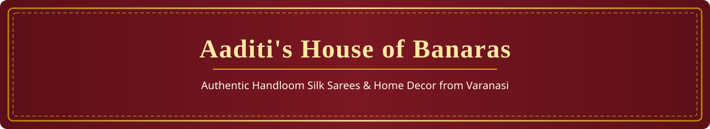

<div align="center">
  
</div>

<br/>

<div align="center">

[](https://kanak0091.github.io/web-dev-capstone/)


**Crafted with heritage & code by [Kanak](https://github.com/Kanak0091) | Web Development Lab 5 Capstone**

</div>

---

## ✨ About the Project

> *"From Weaver's Heart to Your Home — Pure Banaras Craft."*

**Aaditi's House of Banaras** is a responsive, multi-page e-commerce storefront designed for a traditional Banarasi handloom brand rooted in **Mumbai & Varanasi**. Built completely from scratch using semantic **HTML5** and modern **CSS3**, this UI redesign concept brings the warmth of Katan silk, antique gold zari brocade, and heirloom craftsmanship to the web.

---

## 🎨 Brand Colour Palette

| Colour | Role | Hex Code | Usage in UI |
| :---: | :--- | :--- | :--- |
| 🟥 | **Banarasi Maroon** | `#7A1722` | Sticky header, footer, headings & primary CTAs |
| 🟨 | **Antique Zari Gold** | `#D4A017` | Section dividers, border accents & cart buttons |
| ⬜ | **Raw Silk Cream** | `#FDF8F0` | Hero banner, alternating sections & testimonial cards |
| 🌟 | **Soft Gold Tissue** | `#FFE8A3` | Brand title highlight & footer social links |
| ⬛ | **Charcoal Ink** | `#222222` | High-contrast readable body typography |

---

## 🛍️ Pages & Storefront Experience

| Page | File | Key Highlights |
| :--- | :--- | :--- |
| **🏠 Home** | `index.html` | Sticky maroon-and-gold header, accessible skip link, animated welcome hero banner, and 4-column **Featured Highlights** grid. |
| **🧵 Collections** | `collections.html` | Curated 4-column showcase of **Banarasi Silk Sarees**, **Zari Handbags**, **Cushion Covers**, and **Table Runners** with weave details. |
| **🛒 Products** | `products.html` | Full **12-product catalog** featuring real handloom photography, detailed descriptions, INR (`₹`) pricing, and interactive `Add to Cart` buttons. |
| **💛 Why Us** | `about.html` | Brand pillars (authentic Varanasi weaver sourcing, pure silk fabrics, free pan-India shipping above ₹2,000) and verified buyer reviews. |
| **📩 Order Inquiry** | `contact.html` | Accessible custom-order form with paired `<label>` elements, category dropdown selector, HTML5 validation, and instant confirmation popup. |

---

## 📐 Responsive Architecture & CSS Highlights

- **Semantic HTML5 Structure:** Cleanly organized using `<header>`, `<nav>`, `<main>`, `<section>`, `<article>`, and `<footer>` landmarks.
- **CSS Custom Properties (`:root`):** Centralized colour tokens and relative `rem` units for scalable spacing and typography.
- **CSS Grid & Flexbox:**
  - **Flexbox** aligns the sticky navigation bar, full-height sticky footer layout, and uniform product card action buttons.
  - **CSS Grid** drives the responsive category showcase, 12-item product catalog, and customer feedback cards.
- **Adaptive Breakpoints:**
  - 🖥️ **Desktop (`> 1024px`):** `4-column` grid (`repeat(4, 1fr)`) for product and collection cards.
  - 📱 **Tablet (`≤ 1024px`):** `2-column` grid (`repeat(2, 1fr)`) for balanced medium-screen viewing.
  - 📲 **Mobile (`≤ 768px`):** `1-column` (`1fr`) stacked layout with centered header navigation.

---

## 📂 Repository Structure

```text
web-dev-capstone/
├── index.html                  # Landing page with hero banner & category highlights
├── collections.html            # Handloom collections overview
├── products.html               # 12-item product catalog with INR pricing
├── about.html                  # Brand story, USPs & customer testimonials
├── contact.html                # Custom order & inquiry form
├── style.css                   # Theme variables, Grid/Flexbox layouts & responsive queries
├── header-banner.svg           # Custom Banarasi maroon & gold README header banner
├── footer-banner.svg           # Custom Banarasi maroon & gold README footer banner
├── README.md                   # Project documentation
└── *.jpg / *.jpeg              # 12 authentic Banarasi handloom product & category photos

---

<div align="center">
  
</div>
